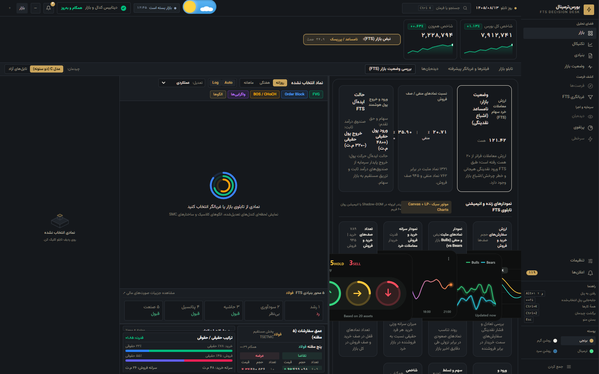
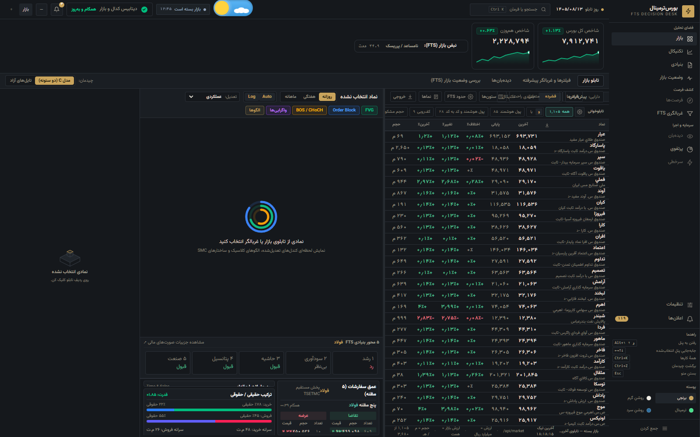
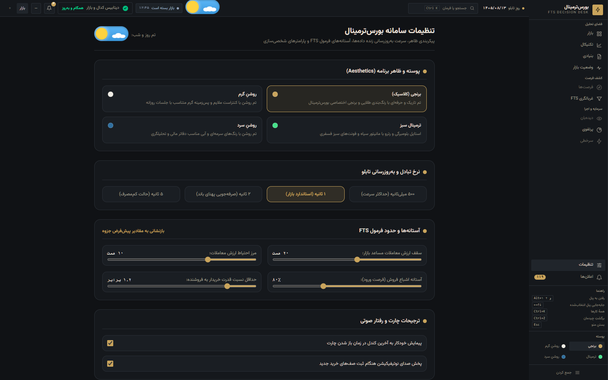

# بورس‌ترمینال اولتیمیت (BorsTerminal Ultimate) ⚡

**میز کار و ایستگاه جامع تصمیم‌گیری معامله‌گران بورس تهران بر پایه متدولوژی FTS**

[-blue.svg)](#دانلود-و-نصب)

> **توجه:** این مخزن تنها **مرکز رسمی انتشار عمومی، مستندات کاربری و دریافت فایل‌های نصبی** نرم‌افزار بورس‌ترمینال است. کدهای منبع این پروژه در مخزن سازمانی خصوصی نگهداری می‌شوند.

---

## 🌟 قابلیت‌ها و بخش‌های اصلی سامانه

### ۱. داشبورد پایش سلامت و نبض بازار (FTS Market Pulse)
ارزیابی آنی وضعیت کلی بازار بر مبنای قوانین مکتوب و ریاضی متدولوژی FTS:
- **سنجش ارزش معاملات خرد سهام:** 
  - ارزش کمتر از **۲۰ همت**: وضعیت بازار **مساعد** و ریسک ورود پایین.
  - ارزش بین **۱۰ تا ۲۰ همت**: مرز احتیاط در خرید و نیاز به ارزیابی دقیق‌تر.
  - ارزش بالای **۲۰ همت**: ورود نقدینگی هیجانی، اشباع بازار و خطر چرخش شاخص.
- **شناسایی فرصت ورود اشباع فروش (Capitulation):**
  - هنگامی که $\ge 80\%$ نمادهای بازار منفی یا در صف فروش قفل می‌شوند، نشانگر هوشمند «فرصت ورود طلایی در سهام بنیادین» فعال می‌گردد.
- **جریان نقدینگی و پول هوشمند:**
  - پایش حالت مطلوب FTS (خروج پایدار سرمایه از صندوق‌های درآمد ثابت و ورود مستقیم به سهام).
- **۷ نمودار زنده Canvas اختصاصی (LP-Charts):**
  - ارزش سفارش‌های خرید و فروش در صفوف
  - روند نمادهای مثبت و منفی (Bulls vs Bears)
  - سرانه خرید و فروش حقیقی معاملات خرد
  - تعداد صف‌های خرید و فروش
  - ورود و خروج پول هوشمند
  - سهم و تسلط صنایع و دسته‌بندی‌ها
  - همگرایی و واگرایی شاخص کل و هم‌وزن

---

### ۲. میز کار مدل C (تابلوی دو ستونه متوازن و غربالگر زنده)
- تابلوی پیشرفته با نرخ نوسازی بالا (زیر ۱ ثانیه) و عدم تأخیر در به‌روزرسانی قیمت‌ها.
- کارت‌های شناور نماد (**Symbol Hover Card**) جهت مشاهده سریع نسبت‌های مالی P/E، سود هر سهم (EPS)، نسبت قدرت خریدار و امتیاز ۵ محور FTS بدون خروج از جدول.
- ابزارهای تحلیل عمق سفارشات، دامنه ۵۲ هفته‌ای قیمت و ترکیب سهامداران.
- پاپ‌اور اختصاصی «تنظیم حدود FTS» برای شخصی‌سازی حدود و آستانه‌های فرمول متناسب با استراتژی معامله‌گر.

---

### ۳. چارت تکنیکال و مهندسی پرایس اکشن (KLineCharts v10)
- **تقویم بومی خورشیدی (جلالی):** نمایش مستقیم تاریخ‌ها (مثلاً ۱۴۰۳/۰۸/۱۰) روی محور افقی.
- **الگویابی هوشمند با اسپات‌لایت سه‌بعدی:** شناسایی الگوهای کلاسیک، سر و شانه، کف/سقف دوگانه و الگوی W/M.
- **زون‌های پرایس اکشن اسمارت‌مانی (SMC):** بلاک‌های سفارش (Order Blocks)، شکاف‌های ارزش منصفانه (FVG)، شکست ساختار و تغییر ماهیت (BOS/CHoCH).
- **واگرایی‌های تکنیکال:** تشخیص خودکار واگرایی‌های معمولی و مخفی در RSI و MACD با پنل اختصاصی.
- **تایم‌فریم‌های درون‌روزی:** کندل‌استیک سریع انیمیشنی برای تایم‌فریم‌های ۱۵ و ۳۰ دقیقه و ۱ و ۴ ساعته.

---

### ۴. شخصی‌سازی، پوسته و تنظیمات جامع
- سوییچ سریع تم روز و شب (**Sky Toggle**) با استایل‌های برنجی (Brass تاریک)، روشنِ گرم، ترمینال سبز و روشنِ سرد.
- کنترل نرخ بازخوانی تابلو (از ۵۰۰ میلی‌ثانیه تا ۵ ثانیه).
- خروجی جدول و گزارش در قالب‌های اکسل (`.xlsx`)، سند باز (`.ods`) و نسخه چاپی PDF با پیوست صورت‌های مالی ۵ محور FTS.

---

## 📥 دانلود و نصب آخرین نسخه

| فایل بسته | نوع | حجم تقریبی | لینک دانلود |
| :--- | :---: | :---: | :---: |
| **نسخه نصبی ویندوز (Setup)** | نصاب رسمی ۶۴ بیتی | ~۴۰ مگابایت | [دانلود از Releases](https://github.com/johnwarchief/BorsTerminal/releases/latest) |
| **نسخه پرتابل (Portable)** | فایل فشرده بدون نیاز به نصب | ~۵۷ مگابایت | [دانلود از Releases](https://github.com/johnwarchief/BorsTerminal/releases/latest) |
| **بانک داده تابلوی بازار (`market.db.lzma`)** | پایگاه داده آفلاین | ~۷۴ مگابایت | [دانلود مستقیم](https://github.com/johnwarchief/BorsTerminal/releases/latest/download/market.db.lzma) |
| **بانک داده صورت‌های مالی کدال (`codal.db.lzma`)** | اطلاعات صورت‌های مالی | ~۳٫۲ مگابایت | [دانلود مستقیم](https://github.com/johnwarchief/BorsTerminal/releases/latest/download/codal.db.lzma) |

---

## 🔒 امنیت، اصالت و به‌روزرسانی هوشمند

1. **امضای رمزنگاری Minisign:** تمامی بسته‌های ارتقا و فایل‌های پایگاه داده با کلید خصوصی معتبر امضا شده و کلاینت پیش از جایگزینی فایل‌ها اصالت و یکپارچگی آن‌ها را بررسی می‌کند.
2. **به‌روزرسانی خودکار و سایلنت:** با انتشار نسخه جدید، نرم‌افزار به‌صورت پس‌زمینه و بدون ایجاد اختلال در کار معامله‌گر، به‌روزرسانی را اعمال می‌نماید.
3. **حفظ پایگاه داده کاربر (`user.db`):** تنظیمات شخصی، دیده‌بان‌ها و یادداشت‌های تحلیلی شما در هنگام به‌روزرسانی نسخه‌ها کاملاً دست‌نخورده باقی می‌ماند.

---

## 📞 پشتیبانی و ارتباط

برای گزارش باگ‌ها، پیشنهادات فنی و دریافت راهنمایی می‌توانید از بخش [Issues](https://github.com/johnwarchief/BorsTerminal/issues) این مخزن استفاده نمایید.
